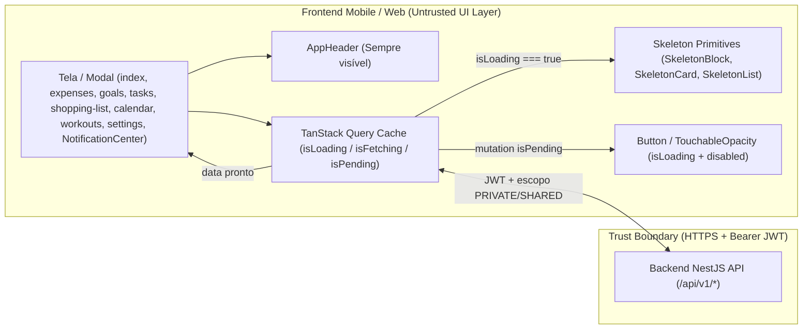
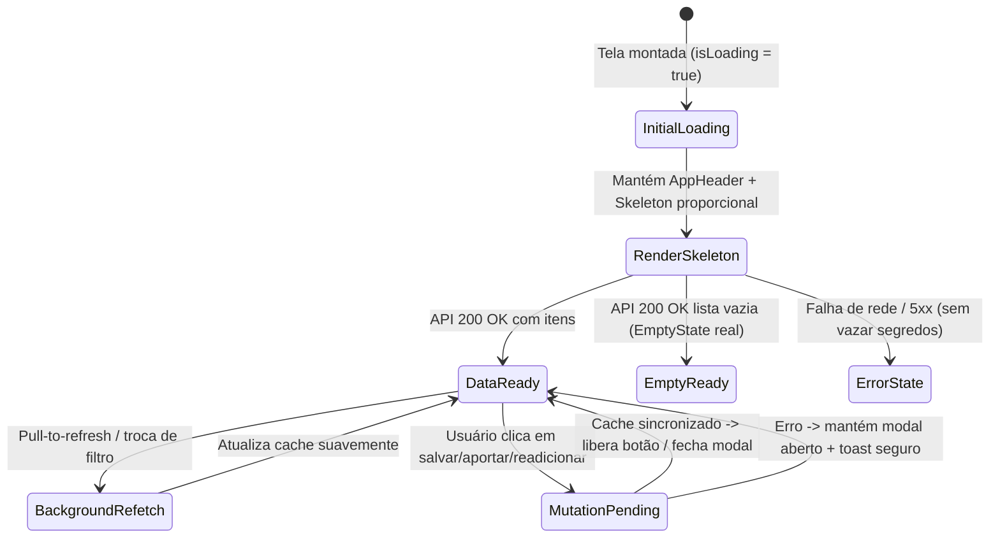

# Design: Skeletons e Estados de Loading Consistentes

## 1. Arquitetura e Fronteiras de Confiança

## 2. Fluxo de Estados de Carregamento (Caminho Feliz e Erro)

## 3. Decisões Arquiteturais (ADRs)

### ADR-01: Skeleton Nativo com `Animated` vs. Biblioteca de Terceiros
- **Opção A (Escolhida)**: Criar `mobile/src/components/Skeleton.tsx` usando `Animated.loop` + `Animated.timing` (opacidade `0.35 ↔ 0.85`, duração `750ms`, `isInteraction: false`, `useNativeDriver: Platform.OS !== 'web'`).
  - **Prós**: Zero novas dependências, 100% compatível com Expo Web / iOS / Android, bundle minúsculo (<2KB), aderente ao `ThemeContext` (Light & Dark), sem risco de quebra com `react-native-web`.
  - **Contras**: Pulso de opacidade em vez de gradiente diagonal animado (suficiente e padrão iOS/Material 3).
- **Opção B (Descartada)**: Instalar `react-native-skeleton-placeholder` ou `moti`.
  - **Contras**: Exigem `expo-linear-gradient` / `masked-view` / `reanimated` com histórico de atrito no Expo Web e maior peso de bundle.

### ADR-02: Manter `AppHeader` Visível Durante o Loading Inicial
- **Decisão**: Substituir `if (isLoading) return <LoadingState />;` nas telas `/expenses`, `/goals`, `/shopping-list` e `/workouts` por renderização condicional *dentro* do container principal, preservando `AppHeader` + título da tela + skeletons do conteúdo.
- **Benefício**: Zero *flash* de tela vazia, navegação pelo menu lateral (`AppDrawer`) continua responsiva mesmo em rede lenta, e redução drástica de CLS.

### ADR-03: Inventário Tela-a-Tela de Skeletons & Loadings
| Tela / Componente | Estado Atual | Novo Comportamento |
|---|---|---|
| `/` (`index.tsx`) | `isLoading` ignorado (exibe `R$ 0,00`) | Skeleton Hero Card + 3 linhas de lançamentos |
| `/expenses` | `<LoadingState />` tela cheia; `isLoadingPreview` e `isLoadingAnalytics` ignorados | Skeleton Resumo + 4 linhas no Extrato; skeletons dedicados em `Fechar Contas` e `Análise` |
| `/goals` | `<LoadingState />` tela cheia; modal aporte sem `isLoading` | Skeleton `Total Guardado` + 2 cards de metas; `isLoading` no botão `+ Guardar Valor` |
| `/tasks` | `isLoading` ignorado (exibe `0 Pendentes` + `EmptyState`) | Skeleton nos 3 KPIs + 4 cards de lembrete |
| `/shopping-list` | `<LoadingState />` tela cheia; `isLoadingTopItems` ignorado | Skeleton lista + skeleton `"Mais Comprados"` + loading em `Limpar` e `+ Adicionar novamente` |
| `/calendar` | `<ActivityIndicator />` cru; `isLoadingSharedCalendars` ignorado | Skeleton pills de agendas + 3 cards skeleton de eventos do dia |
| `/workouts` | `<LoadingState />` tela cheia | Skeleton card do mês/semanas + Constância Semanal + 2 cards de treino |
| `/settings` | Sem skeleton para `useHousehold().isLoading` | Skeleton na seção de membros/espaço compartilhado |
| `NotificationCenterModal` | Sem skeleton para `isLoading` | Skeleton de 3 notificações + loading em `Marcar todas como lidas` |
| `(auth)/*` & `(household)/join` | Revisão de botões de submit | Garantir `isLoading` + `disabled` em 100% dos submits |

## 4. Prisma / Banco de Dados
- Nenhuma alteração em `backend/prisma/schema.prisma` ou migrations (change estritamente de frontend).

## 5. Plano de Testes
1. **Playwright MCP (Interativo)**:
   - Navegar em todas as telas em Mobile (`390×844`) e Desktop (`1280×800`), temas Light e Dark.
   - Validar renderização de skeletons (com throttle/atraso controlado ou inspeção de estado) e transição limpa para os dados reais.
   - Garantir `0` erros em `browser_console_messages` e auditoria de rede limpa.
2. **Testes E2E (`npm run test:e2e`)**:
   - Adicionar cenário de regressão em `e2e/` simulando resposta lenta da API (`delay`) para confirmar que os skeletons (`testID="skeleton-..."`) aparecem durante o carregamento e desaparecem ao carregar os dados.
   - Garantir 100% de aprovação de toda a suíte E2E (53+ testes).
3. **Validação OpenSpec**:
   - `npm run openspec:validate` com exit code `0`.
