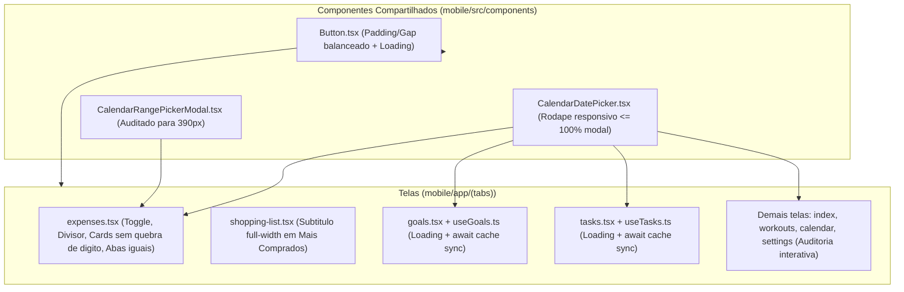
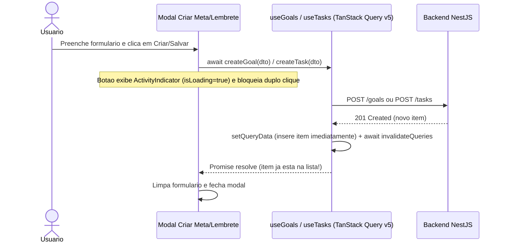

# Design

## Context

Com base nos prints reais enviados pelo usuário e na inspeção do código de `CalendarDatePicker.tsx`, `expenses.tsx`, `shopping-list.tsx`, `useGoals.ts`, `useTasks.ts`, `goals.tsx` e `tasks.tsx`, mapeamos as causas exatas de cada quebra visual e de UX:

1. **`CalendarDatePicker.tsx` (rodapé estourando o modal)**: `Limpar` + `Cancelar` (`Button` com `paddingHorizontal: 20`) + `Confirmar Data` (`minWidth: 130`, `paddingHorizontal: 20`) somam >335px dentro de uma área interna útil de ~318px em telas de 390px.
2. **`expenses.tsx` (card de Balanço + abas)**:
   - Toggle `Meu Balanço Individual` / `Em Conjunto (Casal)`: sem `paddingHorizontal` adequado e texto desalinhado à esquerda, colando o ícone `👥` na borda esquerda da pílula roxa.
   - Separador horizontal abaixo de `Renda Conjunta` / `Despesas da Casa`: falta `marginTop` / `paddingBottom` antes do divisor.
   - Grid de 3 colunas (`Total da Casa` | `Divisão 50/50` | `Privado do Par`): 3 colunas lado a lado em ~310px deixam ~90px por coluna, forçando quebra no meio dos dígitos (`R$ 630,6` / `5` e `R$ 315,3` / `2 cada`).
   - Abas `Extrato` / `Fechar Contas` / `Análise`: textos com comprimentos muito distintos sem `minHeight` uniforme e `paddingHorizontal` balanceado fazem `Fechar Contas` parecer espremido.
3. **`shopping-list.tsx` ("🔥 Mais Comprados pelo Casal")**: container interno do título/subtítulo sem `flex: 1, minWidth: 0`.
4. **`useGoals.ts` & `useTasks.ts` + `goals.tsx` & `tasks.tsx` (UX de criação)**: `onSuccess` chama `queryClient.invalidateQueries(...)` sem `return`/`await`, encerrando `mutateAsync` antes do refetch terminar; o modal fecha imediatamente enquanto o item ainda não apareceu na tela.

## Architecture & Flow

### Fluxo Sincronizado de Criação (Metas & Lembretes)

## Decisions (ADRs)

- **ADR-01 — Rodapé Responsivo no `CalendarDatePicker`**:
  - *Escolha*: Usar `flexWrap: 'wrap'`, `gap: 8` e botões compactos (`paddingHorizontal: 12`, `paddingVertical: 9`, sem `minWidth: 130` rígido) no rodapé do `CalendarDatePicker` (e revisar `CalendarRangePickerModal`).
  - *Prós*: Funciona em 320px, 375px, 390px e desktop sem nunca sair do modal.
- **ADR-02 — Layout Anti-Quebra de Valores Monetários no Card de Balanço (`expenses.tsx`)**:
  - *Escolha*: Para o bloco inferior de 3 métricas (`Total da Casa`, `Divisão 50/50`, `Privado do Par`), usar `flexWrap: 'wrap'` com cards de `minWidth: '45%'` (grid 2 colunas + 1 full-width quando houver 3 itens, ou 2 colunas limpas quando houver 2 itens) + `numberOfLines={1}` + `adjustsFontSizeToFit`, e `marginVertical: 14` no divisor horizontal.
  - *Prós*: Zero quebra no meio de números (`R$ 630,65`, `R$ 315,32 cada`) mesmo com valores acima de `R$ 10.000,00`.
- **ADR-03 — Padronização de Ícone ↔ Texto & Abas Simétricas**:
  - *Escolha*: Separar ícone e texto com `gap: 8` (ou espaçamento adequado) e `paddingHorizontal: 10–12` nos toggles (`Meu Balanço Individual` / `Em Conjunto (Casal)`) e abas (`Extrato` / `Fechar Contas` / `Análise`) com `minHeight: 42`, `justifyContent: 'center'`, `alignItems: 'center'`, `textAlign: 'center'`.
- **ADR-04 — Loading + Fechamento Sincronizado em Metas e Lembretes**:
  - *Escolha*: Em `useGoals.ts` e `useTasks.ts`, no `onSuccess` de `create*`, atualizar imediatamente a lista via `queryClient.setQueryData` com o registro retornado e `await queryClient.invalidateQueries(...)`. Nos modais (`goals.tsx`, `tasks.tsx`), passar `isLoading={isCreating}` e `disabled={isCreating}` no botão de submit e fechar o modal apenas após `await createGoal(...)` / `await createTask(...)` resolver.

## Prisma & Security Review

- **Prisma**: Sem alterações em `backend/prisma/schema.prisma`.
- **Segurança & Privacidade**: Nenhuma alteração em auth, tokens ou isolamento `PRIVATE` vs `SHARED`.

## Testing Plan

1. **Auditoria Interativa via Playwright MCP (`390×844` + `1280×800`, Light + Dark)**:
   - Abrir e inspecionar:
     - `/expenses`: toggle `Individual`/`Casal`, separador horizontal, 3 métricas sem quebra de número, abas `Extrato`/`Fechar Contas`/`Análise`, modal `Período (Datas)`.
     - `/workouts`: abrir modal de criar treino e abrir `CalendarDatePicker` verificando `confirmBtn.right <= modal.right`.
     - `/goals`: abrir modal de criar meta, abrir `CalendarDatePicker`, submeter e verificar loading + fechamento após item visível.
     - `/tasks`: abrir modal de criar lembrete, abrir `CalendarDatePicker`, submeter e verificar loading + fechamento após item visível.
     - `/shopping-list`: verificar subtítulo de `"🔥 Mais Comprados pelo Casal"`.
     - `/calendar`, `/`, `/settings`: verificar espaçamentos ícone↔texto e 0 overflows.
   - Confirmar `0` erros em `browser_console_messages` e capturar screenshots de evidência.
2. **Testes E2E (`npm run test:e2e`)**:
   - Garantir 100% dos 53+ testes passando (incluindo verificação de `CalendarDatePicker` contido no modal).
