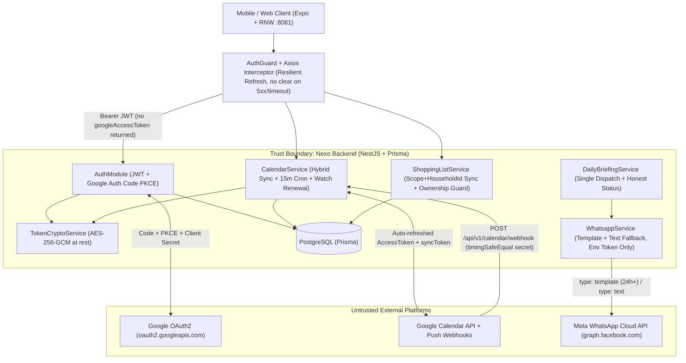
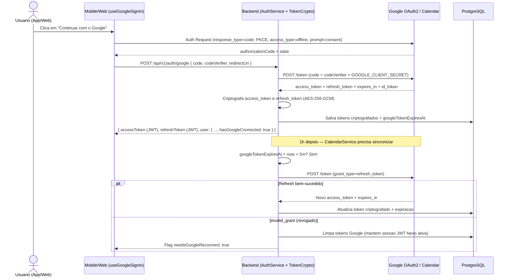

# Design

## Context

A auditoria técnica do código e a inspeção interativa via **Playwright MCP** em `http://localhost:8081` (`390×844`) revelaram que os 5 problemas reportados compartilham causas estruturais ligadas a: (1) ciclo de vida de tokens (JWT/Refresh no cliente + ausência de `googleRefreshToken` no backend), (2) integração proativa com WhatsApp fora da janela de 24h e token hardcoded, (3) sincronização de Google Calendar sem renovação de token/canais nem fallback periódico, (4) dessincronização entre `scope` e `householdId` em `update()` de `ShoppingListService` e `CalendarService`, e (5) containers horizontais sem `flexWrap`/scroll em telas mobile.

## Goals / Non-Goals

**Goals:**
- Eliminar quedas indevidas de sessão e expiração silenciosa de 1h da conta Google.
- Garantir entrega real e observável do resumo diário no WhatsApp (com Template Message fora da janela de 24h e sem duplicação).
- Garantir sincronização automática contínua do Google Calendar (webhook autenticado + polling incremental a cada 15 min).
- Corrigir o desaparecimento de itens na Lista de Compras ao mudar `PRIVATE` ↔ `SHARED`, corrigindo também o mesmo padrão na Agenda e fechando IDOR.
- Zerar overflows/cortes horizontais em viewport Mobile 390×844 e Desktop 1280×800 e remover código morto e artefatos soltos.

**Non-Goals:**
- Refatorar módulos não afetados ou reescrever integrações Garmin/Strava/MFIT.
- Alterar visualmente telas que já passaram sem overflow na auditoria (`/goals`, `/calendar`, `/settings`), salvo ajustes pontuais se encontrados na validação final.

## Architecture & Trust Boundaries



## Sequence Diagrams (Happy Path & Security/Error Flows)

### 1. Google OAuth Code + PKCE & Renovação Transparente de Token



### 2. Resumo Diário WhatsApp (Template vs Janela 24h) & Shopping Scope Update

```mermaid
sequenceDiagram
    participant Cron as DailyBriefingService
    participant WA as WhatsappService
    participant Meta as Meta WhatsApp Cloud API
    participant Notif as NotificationsService

    Cron->>WA: sendDailyBriefingMessage(phone, templateParams, fallbackText)
    alt WHATSAPP_DAILY_TEMPLATE_NAME configurado
        WA->>Meta: POST /messages (type: "template")
    else Sem template configurado
        WA->>Meta: POST /messages (type: "text")
    end
    alt Entrega confirmada (messageId)
        Meta-->>WA: 200 OK { messages: [{ id }] }
        WA-->>Cron: { delivered: true, messageId }
    else Falha (ex.: #131047 janela 24h)
        Meta-->>WA: 400 Error
        WA-->>Cron: { delivered: false, errorCode, errorMessage }
    end
    Cron->>Notif: dispatchNotification(..., skipWhatsapp: true)
    Note over Cron,Notif: Sem envio duplicado no WhatsApp; In-App + Push entregues normalmente
```

## Decisions (ADRs)

- **ADR-01 — Criptografia de Tokens OAuth em Repouso (`TokenCryptoService`)**:
  - *Escolha*: AES-256-GCM via `node:crypto` com chave derivada de `TOKEN_ENCRYPTION_KEY` (fallback derivado de `JWT_SECRET` apenas com warning em dev), prefixando valores como `enc:v1:<iv>:<tag>:<cipher>` para migração retrocompatível sem downtime.
  - *Trade-offs*: Zero dependências externas; protege tokens mesmo em caso de vazamento de backup SQL (`local_data_backup.sql`). Exige configurar `TOKEN_ENCRYPTION_KEY` em produção (Render).
- **ADR-02 — Google OAuth Authorization Code + PKCE (com compatibilidade transitória)**:
  - *Escolha*: Suportar `code` + `codeVerifier` + `redirectUri` em `/auth/google` e `/calendar/connect-google`, mantendo fallback de `accessToken` apenas para dev/E2E (`dev_token_`) e ambientes sem `GOOGLE_CLIENT_SECRET` (com aviso no log).
  - *Trade-offs*: Permite rollout progressivo sem quebrar E2E nem travar o app enquanto o usuário configura `GOOGLE_CLIENT_SECRET`.
- **ADR-03 — Resiliência de Sessão no Cliente (`api.ts` + `_layout.tsx`)**:
  - *Escolha*: Aumentar `timeout` do `apiClient` para `25000ms` (tolerando cold start do Render); limpar tokens no interceptor **somente** se `/auth/refresh` retornar `401` ou `403`; adicionar `retry: 2` com backoff exponencial em `userQuery` (`AuthGuard`) para erros de rede/5xx; só disparar `getMe()` quando existir token ou refreshToken no storage (eliminando loop na tela `/login`).
  - *Trade-offs*: Evita logouts falsos em conexões móveis instáveis; mantém revogação imediata quando a sessão realmente expira no servidor.
- **ADR-04 — WhatsApp Template Message + Remoção de Token Hardcoded**:
  - *Escolha*: Remover `permanentFallbackToken` imediatamente; adicionar `sendTemplateMessage()` com `WHATSAPP_DAILY_TEMPLATE_NAME` (e `WHATSAPP_TEMPLATE_LANG`, default `pt_BR`) mapeando os 4 parâmetros do resumo atual de `daily-briefing.service.ts` (`{{1}}` nome, `{{2}}` agenda, `{{3}}` tarefas, `{{4}}` lista de compras) com sanitização obrigatória de `\n`/`\t`/espaços múltiplos (regra Meta `#132018`) e truncamento seguro; retornar `{ delivered, messageId, errorCode, errorMessage }`; adicionar flag `skipWhatsapp` em `NotificationsService.dispatchNotification()` para evitar envio duplicado no `DailyBriefingService`.
  - *Trade-offs*: Preserva exatamente a estrutura visual do resumo atual e garante entrega 100% confiável fora da janela de 24h assim que o template `UTILITY` for aprovado na Meta.
- **ADR-05 — Google Calendar Híbrido (Webhook Autenticado + Polling 15 min)**:
  - *Escolha*: Persistir `webhookSecret` em `GoogleCalendarSyncState`, corrigir URL de callback para `/api/v1/calendar/webhook`, validar `channelToken` com `crypto.timingSafeEqual`, registrar webhooks automaticamente após conectar Google (quando `API_PUBLIC_URL` for HTTPS) e rodar um intervalo periódico de 15 minutos que renova canais expirando (< 24h) e executa `syncIncremental` via `syncToken` para usuários conectados.
  - *Trade-offs*: Consistência garantida tanto em produção (near real-time via webhook) quanto em fallback/dev (polling leve com `syncToken`).
- **ADR-06 — Integridade `scope`/`householdId` e Ownership Guard**:
  - *Escolha*: Em `ShoppingListService` (`update`, `toggleComplete`, `delete`) e `CalendarService` (`update`, `delete`), validar que o registro pertence ao `userId` ou ao `householdId` (quando `SHARED`) antes de mutar; ao alterar `scope`, sempre recalcular `householdId = nextScope === SHARED ? user.householdId : null` (rejeitando `SHARED` se o usuário não tiver `householdId`). Emitir `SHOPPING_UPDATED` no `update()` e invalidar `queryKeys.shoppingList.all` no frontend.
- **ADR-07 — Correções de Layout Mobile-First (390×844) e Limpeza**:
  - *Escolha*: Aplicar `flexWrap: 'wrap'` / `minWidth: 0` / `ScrollView horizontal` explícito nos headers e barras de filtro de `shopping-list.tsx`, `expenses.tsx`, `workouts.tsx`, `tasks.tsx`, e melhorar alocação de largura dos títulos em `index.tsx` e `expenses.tsx`. Proteger `expo-notifications` com `Platform.OS !== 'web'`. Remover `context7.config.ts`, `GET /calendar/context7-anchor`, `ErrorState.tsx` e os 12 `.png` soltos na raiz.

## Prisma Schema Review Checklist (`backend/prisma/schema.prisma`)

- **Migração segura (*expand-and-contract*)**: Apenas 2 novas colunas **nullable** (100% aditivas, zero perda de dados, zero downtime):
  - `User.googleTokenExpiresAt DateTime?`
  - `GoogleCalendarSyncState.webhookSecret String?`
- **`onDelete` explícito**: Nenhuma relação alterada; integridade referencial existente preservada.
- **Índices (`@@index`)**: Adicionar `@@index([googleRefreshToken])`? **Não** (nunca indexar segredos!). Adicionar `@@index([expiration])` em `GoogleCalendarSyncState` para consultas eficientes de renovação de canais próximos de expirar.
- **Tipos & Timestamps**: `DateTime` em UTC (`googleTokenExpiresAt`, `expiration`).
- **Criptografia de campos sensíveis**: `User.googleAccessToken` e `User.googleRefreshToken` criptografados com AES-256-GCM antes de persistir e **removidos** dos `select` retornados ao cliente (expondo apenas `hasGoogleConnected: Boolean(user.googleAccessToken || user.googleRefreshToken)`).
- **Impacto em `seed.ts`, `packages/shared` e `e2e/helpers/mockApi.ts`**:
  - `seed.ts`: sem impacto (colunas nullable).
  - `packages/shared`: atualizar `GoogleAuthDto` (suportar `code`, `codeVerifier`, `redirectUri` opcionais além de `accessToken`) e `UserDto` (`hasGoogleConnected?: boolean`).
  - `e2e/helpers/mockApi.ts`: atualizar mock de `PUT /shopping-list/:id` para sincronizar `scope`/`householdId` e mock de `/auth/*` com `hasGoogleConnected`.

## Testing Plan

1. **Testes Unitários NestJS (`backend/`)**:
   - `TokenCryptoService`: encrypt/decrypt AES-256-GCM, retrocompatibilidade com texto puro legado, rejeição de payload adulterado.
   - `AuthService`: troca de `code` + PKCE, renovação automática de `googleAccessToken`, tratamento de `invalid_grant`, garantia de que `googleAccessToken` não vaza nas respostas HTTP.
   - `WhatsappService` & `DailyBriefingService`: envio via `type: 'template'`, fallback `type: 'text'`, retorno `{ delivered: false }` em erro da Meta, ausência de duplicação de WhatsApp.
   - `CalendarService`: validação de `webhookSecret` com `timingSafeEqual` (rejeita 401/403 se inválido), sincronização `scope`/`householdId` no `update()`.
   - `ShoppingListService`: mudança `PRIVATE -> SHARED` e `SHARED -> PRIVATE` preservando visibilidade/isolamento, `importSpreadsheet` respeitando `PRIVATE`, bloqueio de IDOR cross-user.
2. **Validação Interativa via Playwright MCP (`http://localhost:8081`)**:
   - Mobile `390×844` + Desktop `1280×800`, Light + Dark em `/`, `/shopping-list`, `/expenses`, `/workouts`, `/tasks`, `/calendar`, `/goals`, `/settings`.
   - Auditoria programática de overflow (`0` elementos cortados), `browser_console_messages` (`0` erros), `browser_network_requests` (nenhum `googleAccessToken` exposto e nenhum loop em `/login`) e screenshots.
3. **Testes E2E Automatizados (`npm run test:e2e`)**:
   - Adicionar cenários em `e2e/shopping-list.spec.ts` (editar item de `PRIVATE` para `SHARED` e validar que permanece visível em "Todos" e "Compartilhado").
   - Adicionar/atualizar cenários em `e2e/auth.spec.ts` (sessão preservada em falha transitória 503 sem deslogar).
   - Garantir **100%** dos testes passando em `npm run test:e2e`.

## Risks / Trade-offs

- **Dependência de configuração externa**: Para o refresh perpétuo do Google (D2-A) e entrega garantida fora da janela de 24h no WhatsApp (D3-A) funcionarem em produção, o usuário precisará adicionar `GOOGLE_CLIENT_SECRET`, `TOKEN_ENCRYPTION_KEY`, `API_PUBLIC_URL` e `WHATSAPP_DAILY_TEMPLATE_NAME` (após aprovar o template na Meta) e rotacionar o token WhatsApp exposto no código antigo.
- **Compatibilidade de testes existentes**: Remover `googleAccessToken` do payload HTTP exige atualizar o hook `useGoogleCalendarAuth` para ler `user?.hasGoogleConnected` (com fallback temporário seguro durante a transição).
